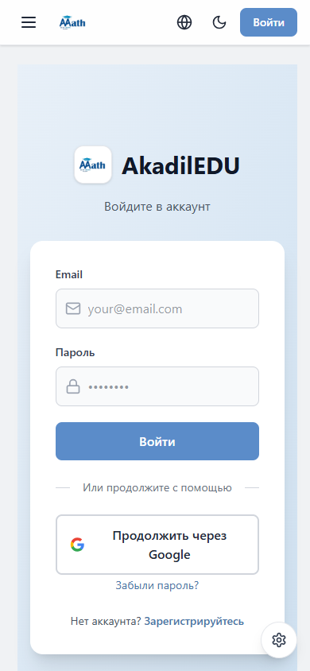

<p align="center">
  <a href="https://akadiledu.web.app">
    
  </a>
</p>

<h1 align="center">AkadilEDU</h1>

<p align="center"><strong>Learn here. Prove yourself anywhere.</strong></p>

<p align="center">
  <a href="https://akadiledu.web.app">Open the platform</a> ·
  <a href="#ecosystem">Explore the ecosystem</a> ·
  <a href="https://github.com/AQADIL/AkadilEDU-PRIME">AkadilEDU PRIME</a>
</p>

---

AkadilEDU brings video courses, lesson practice and exam preparation into one learning space. Follow a course, return to where you left off and put what you have learned to the test.

## A look inside

The sign-in experience on desktop and mobile.

<table>
  <tr>
    <th width="75%">Desktop</th>
    <th width="25%">Mobile</th>
  </tr>
  <tr>
    <td valign="top"></td>
    <td valign="top"></td>
  </tr>
</table>

## Learn. Practice. Progress.

| | What you can do |
| --- | --- |
| **Courses** | Work through modules, video lessons and supporting materials. |
| **Practice** | Check your understanding with lesson quizzes and topic tests. |
| **Exam preparation** | Take timed ҰБТ practice tests and review your answers. |
| **Progress** | Resume lessons and revisit previous test results. |
| **Your learning space** | Switch between light and dark themes on desktop or mobile. |

For educators, the administration panel brings course content, enrollments, question banks and notifications together.

## Ecosystem

Two products, one learning ecosystem: structured study on the web and regular practice through Telegram.

| Product | Focus | Explore |
| --- | --- | --- |
| **AkadilEDU** | Video courses, learning materials and exam practice. | [Platform](https://akadiledu.web.app) · [Repository](https://github.com/AQADIL/AkadilEDU) |
| **AkadilEDU PRIME** | Telegram bot for mathematics practice, daily channel quizzes and personal mistake review. | [Repository](https://github.com/AQADIL/AkadilEDU-PRIME) |

AkadilEDU provides the course experience. PRIME makes short, focused practice part of the daily routine.

## Built with

**React · Vite · Tailwind CSS · Firebase**

Firebase Authentication handles sign-in; Realtime Database and Storage hold learning data and materials. Cloud Functions handle privileged operations. GitHub Actions checks changes and deploys to Firebase Hosting.

## Development

<details>
<summary><strong>Local setup and checks</strong></summary>

Development requires permission from the project owner, Node.js 22.12 or later and a configured Firebase project.

```sh
git clone https://github.com/AQADIL/AkadilEDU.git
cd AkadilEDU
npm ci
npm ci --prefix functions
```

Copy [`.env.example`](.env.example) to `.env` and fill in your Firebase configuration, development host and port. Enable the required authentication providers and deploy the project's Functions and access rules before testing connected features.

```sh
npm run dev
```

| Command | Purpose |
| --- | --- |
| `npm run check` | Security checks, lint, tests and a production build. |
| `npm test` | Application tests; rule tests require Firebase emulators. |
| `npm run build` | Production build. |

The [Firebase workflow](.github/workflows/check.yml) also runs dependency audits and Database/Storage emulator tests before deployment.

Keep private credentials on the server. All `VITE_*` values are visible in the browser. Interface translations live in [`src/i18n.js`](src/i18n.js).

</details>

## Ownership

Created and owned by **Akadil Alish**.

Copyright © 2026 Akadil Alish. All rights reserved. This is proprietary software: reuse, modification, redistribution or deployment requires prior written permission. See [LICENSE](LICENSE) for the full terms and third-party exceptions.

[Report a bug](https://github.com/AQADIL/AkadilEDU/issues) · [Security policy](SECURITY.md)
