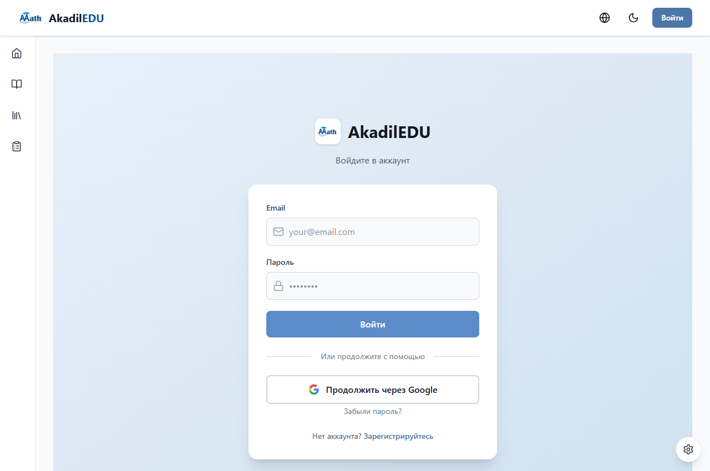
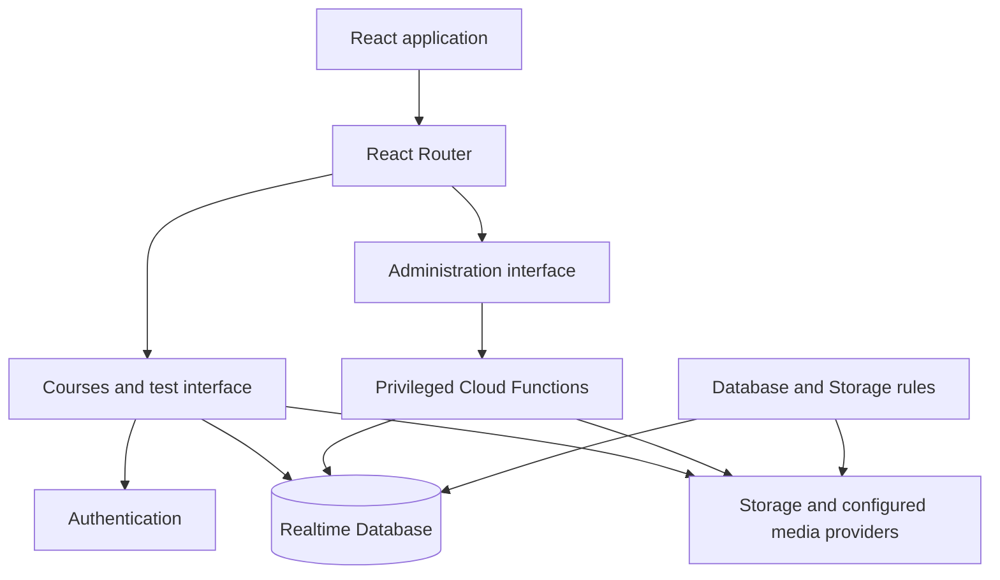

<a id="readme-top"></a>

<p align="center">
  <a href="https://akadiledu.web.app">
    
  </a>
</p>

<h1 align="center">AkadilEDU</h1>

<p align="center">
  <strong>Learn here. Prove yourself anywhere.</strong>
</p>

<p align="center"><a href="#learning-experience">Features</a> · <a href="#product-preview">Preview</a> · <a href="#development">Getting started</a> · <a href="#akadiledu-ecosystem">Ecosystem</a> · <a href="SECURITY.md">Security</a> · <a href="LICENSE">Licence</a></p>

> **Intellectual property - all rights reserved.** Copyright © 2026 Akadil Alish. The original source code, documentation and brand assets are proprietary. Use, copying, modification, redistribution and deployment require prior written permission, subject to the exceptions and preserved rights in [LICENSE](LICENSE). Public repository visibility does not grant a reuse licence.

AkadilEDU is a web learning platform for courses, lesson practice and preparation for Kazakhstan's Unified National Testing (UNT / ҰБТ / ЕНТ). It gives students a place to follow structured material, practise independently and return to their results. Educators manage the content and access from the same application.

## Explore this guide

<details>
<summary><strong>Open the section navigator</strong></summary>

- [Start here](#start-here)
- [AkadilEDU ecosystem](#akadiledu-ecosystem)
- [Learning experience](#learning-experience)
- [Product preview](#product-preview)
- [Educator workspace](#educator-workspace)
- [Architecture](#architecture)
- [Technology](#technology)
- [Repository map](#repository-map)
- [Development](#development)
- [Verification](#verification)
- [Project boundaries](#project-boundaries)
- [Questions before you start](#questions-before-you-start)
- [Ownership](#ownership)

</details>

## Start here

| Your goal | Go directly to | What to expect |
| --- | --- | --- |
| Study or continue a course | [Open AkadilEDU](https://akadiledu.web.app/) | Sign in and access the courses assigned to your account |
| See what the platform offers | [Learning experience](#learning-experience) | Courses, lesson practice, tests and progress |
| Explore short Telegram practice | [Meet AkadilEDU PRIME](https://github.com/AQADIL/AkadilEDU-PRIME/blob/main/README.product.md) | Channel quizzes and personal mistake review |
| Run an authorised environment | [Development](#development) | Expand installation, environment and execution instructions |

## AkadilEDU ecosystem

<table align="center">
<tr>
<td width="1000" align="center">

<p align="center">
  <strong>AkadilEDU</strong> is the parent learning brand. <strong>AkadilEDU PRIME</strong> is its Telegram practice sub-brand.<br>
  Select a logo or product name to move between the two guides.
</p>

<p align="center">
  <a href="https://github.com/AQADIL/AkadilEDU/blob/main/README.product.md">
    <br>
    <strong>AkadilEDU</strong>
  </a><br>
  <sub>PARENT BRAND · WEB/PWA</sub><br>
  Courses, video lessons and exam preparation.<br>
  <strong>Current guide</strong>
</p>

<p align="center">
  <strong>↓</strong><br>
  <sub>Telegram practice sub-brand</sub>
</p>

<p align="center">
  <a href="https://github.com/AQADIL/AkadilEDU-PRIME/blob/main/README.product.md">
    <br>
    <strong>AkadilEDU PRIME</strong>
  </a><br>
  <sub>TELEGRAM PRACTICE</sub><br>
  Channel quizzes, mistake review and focused topic practice.<br>
  <a href="https://github.com/AQADIL/AkadilEDU-PRIME/blob/main/README.product.md">Open the PRIME guide →</a>
</p>

</td>
</tr>
</table>

The brand relationship connects the product family. The two applications currently keep separate learner records; verified account linking and shared progress remain planned integrations.

## Learning experience

### Follow a course from lesson to practice

Courses are organised into named modules, video lessons and supporting materials. Students open their assigned courses, work through the content and resume their study. Lesson quizzes let them check understanding alongside the material.

### Practise under exam conditions

The test experience includes timed practice, question navigation and answer review. Students can revisit results and inspect their answers after an attempt. Course study and test practice are accessible from the same account.

### Keep your learning space familiar

The interface supports Kazakh, Russian and English, with light and dark themes and responsive layouts. A web app manifest provides the application's standalone presentation metadata and icons. Connected learning features require the configured backend and network access; offline course playback is not promised.

| A student's task | Where it happens | What the application provides |
| --- | --- | --- |
| Find learning material | Course catalogue | Course descriptions and available content |
| Continue an assigned course | My courses | Access to enrolled courses and lesson progress |
| Work through a topic | Course player | Video, supporting material and lesson quizzes |
| Prepare for UNT | Practice tests | Timed attempts, question navigation and answer review |
| Return to previous work | Course and test records | Saved progress and results |
| Manage an account | Account and profile flows | Sign-in, email verification and password recovery |

## Product preview

The current desktop sign-in experience. Course content and student records require an authorised account.

<p align="center">
  
</p>

## Educator workspace

The administration interface brings content and learner management into the application:

| Area | Available tools |
| --- | --- |
| Course content | Named modules, lessons, video configuration and supporting materials |
| Assessment content | Question editing, context blocks, test construction and variants |
| Learner access | Course assignments, user management and account status |
| Communication | Server-backed notification operations |
| Operational review | Administrative activity and security-related views |

Privileged operations are implemented in server functions and database rules. A browser route guard controls navigation; the backend remains responsible for authorisation.

## Architecture

<details>
<summary><strong>Explore the application architecture and data flow</strong></summary>

React supplies the browser interface, React Router handles navigation, and Vite builds the application. Backend SDK calls are grouped in the Firebase modules, while Cloud Functions implement privileged actions.



These diagrams describe the product at repository level. They are not a claim that the separate Web and Telegram services already share a learner account or progress model.

</details>

## Technology

<details>
<summary><strong>View the technology stack and implementation roles</strong></summary>

| Layer | Technology | Purpose |
| --- | --- | --- |
| Interface | React 18, React Router | Component UI and application navigation |
| Build | Vite 7 | Development server and production bundling |
| Styling and interaction | Tailwind CSS, Headless UI, Framer Motion | Responsive layouts, accessible primitives and transitions |
| Languages | i18next, react-i18next | Kazakh, Russian and English interface text |
| Mathematics and documents | KaTeX, PDF.js | Mathematics rendering and document handling |
| Learning services | Firebase Authentication, Realtime Database, Storage | Accounts, application data and material storage |
| Server | Node.js 22, Cloud Functions | Privileged operations and service integration |
| Quality | ESLint, Node.js test runner, Firebase rule tests | Source checks, behavioural tests and access-rule checks |
| Delivery | GitHub Actions, Firebase Hosting | Validation and configured deployment |

Exact dependency declarations are in [`package.json`](package.json) and [`functions/package.json`](functions/package.json); lockfiles record resolved versions.

</details>

## Repository map

<details>
<summary><strong>Browse source directories and their responsibilities</strong></summary>

| Path | Responsibility |
| --- | --- |
| [`src/pages/`](src/pages/) | Learner pages, account flows and administration routes |
| [`src/components/`](src/components/) | Course player, lesson quizzes, tests and shared UI |
| [`src/components/admin/`](src/components/admin/) | Course, question and test editing |
| [`src/firebase/`](src/firebase/) | Client authentication, data, messaging and material access |
| [`src/i18n.js`](src/i18n.js) | Interface translations |
| [`functions/`](functions/) | Server-side operations and administrative AI processing |
| [`tests/`](tests/) | Application, validation, translation and access-rule tests |
| [`scripts/`](scripts/) | Security checks, administration and release tooling |
| [`public/manifest.json`](public/manifest.json) | Web app presentation metadata |
| [`database.rules.json`](database.rules.json), [`storage.rules`](storage.rules) | Client access rules |
| [`.github/workflows/check.yml`](.github/workflows/check.yml) | CI checks and deployment configuration |

</details>

## Development

<details>
<summary><strong>Installation, environment configuration and local execution</strong></summary>

### Prerequisites

Development requires the owner's permission, Node.js 22.12 or later, npm and a Firebase project that you are authorised to use. Cloud Functions target the Node.js 22 runtime. Repository access does not provide access to the production database, paid content or administrator accounts.

### Install dependencies

```sh
git clone https://github.com/AQADIL/AkadilEDU.git
cd AkadilEDU
npm ci
npm ci --prefix functions
```

### Configure the environment

Copy [`.env.example`](.env.example) to a local `.env`, and [`functions/.env.example`](functions/.env.example) to `functions/.env` when working with the backend. Fill in the actual values for your environment.

| Configuration group | What it controls |
| --- | --- |
| `VITE_FIREBASE_*` | Public browser project configuration, messaging and function region |
| `VITE_DEV_HOST`, `VITE_DEV_PORT` | Local development binding |
| `VITE_SUPPORT_*` | Configured support destinations |
| `VITE_IP_LOOKUP_URL`, `VITE_VIDEO_EMBED_ORIGIN` | Optional integrations referenced by the application |
| `GEMINI_API_URL`, `DATABASE_REGION` | Server configuration in the Functions template |

All `VITE_*` values are included in the browser bundle. Keep private API credentials, service-account keys and administrative secrets outside frontend configuration and version control.

Enable the authentication providers used in your environment, authorise the relevant domains, deploy the Functions and access rules, and provision real course and test content before expecting connected learning flows to work. Missing configuration is shown as unavailable; there is no bundled demonstration dataset or default administrator password.

### Run locally

```sh
npm run dev
```

Vite reads the host and port from your environment. To inspect a production build locally:

```sh
npm run build
npm run preview
```

### Deployment

[`firebase.json`](firebase.json) declares Hosting, Functions and the data rules. Hosting serves `dist`; its predeploy hook builds the frontend. The configured GitHub Actions workflow runs its checks before the production deployment job and verifies published assets afterwards. Cloud project permissions, identity federation, service configuration and secrets must be supplied by an authorised operator.

</details>

## Verification

<details>
<summary><strong>Checks, builds and connected workflow verification</strong></summary>

| Command | Purpose |
| --- | --- |
| `npm run check` | Security scan, lint, application tests and production build |
| `npm run check:security` | Repository security checks |
| `npm run lint` | ESLint checks |
| `npm test` | Node.js tests; emulator-dependent checks need their services |
| `npm run build` | Production bundle |
| `npm run format:check` | Formatting checks for the configured source paths |

The [CI workflow](.github/workflows/check.yml) also audits dependencies and explicitly runs Database and Storage rule tests with Firebase emulators. A successful build alone does not establish that an external service, production deployment or every student workflow is working.

For a manual connected check, sign in with an authorised test account, open an assigned course, complete a lesson interaction, take a practice test and confirm the result is available after returning to the application. Keep actual learner data out of public screenshots and issue reports.

</details>

## Project boundaries

<details>
<summary><strong>Read current limitations and integration boundaries</strong></summary>

Course access depends on enrolment, backend rules and the material available in the configured environment. The PWA manifest does not make streamed media available offline. Telegram progress synchronisation and student-facing AI learning plans remain planned integration work; no measured learning improvement is claimed here.

</details>

## Questions before you start

<details>
<summary><strong>Can I reuse or deploy the source code?</strong></summary>

Prior written permission from Akadil Alish is required under [LICENSE](LICENSE). Public visibility does not grant a reuse or deployment licence. Third-party terms and the preserved rights in the licence continue to apply.

</details>

<details>
<summary><strong>Do Web and Telegram already share learner progress?</strong></summary>

The applications currently keep separate learner records. Verified account linking, shared topic progress and student learning plans remain planned product integrations.

</details>

<details>
<summary><strong>Does opening the repository provide a working account?</strong></summary>

Repository access does not grant access to production records, student enrolments or administrator accounts. Use the hosted application with an authorised account, or configure an environment you are permitted to operate using the setup instructions.

</details>

## Ownership

**The original AkadilEDU source, documentation and brand assets are the intellectual property of Akadil Alish.**

Created and maintained by **[Akadil Alish / AQADIL](https://github.com/AQADIL)**.

Copyright © 2026 Akadil Alish. All rights reserved. The original source, documentation and brand assets are proprietary. Use, modification, redistribution and deployment require prior written permission, subject to the terms and third-party exceptions in [LICENSE](LICENSE).

[Security policy](SECURITY.md) · [Report a product issue](https://github.com/AQADIL/AkadilEDU/issues) · [Contact the owner](https://github.com/AQADIL)

<p align="right"><a href="#readme-top">Back to top ↑</a></p>
