# AkadilEDU Probationary Period 1 report

## 1 Project proposal

### Problem and users

After a mathematics test, a learner needs to decide which topic to study next. AkadilEDU offers longer course sessions on the web and short practice in Telegram. At present, the two applications keep separate learner records. I will connect those records so that recommendations can use practice from both channels.

The primary users are students preparing for UNT mathematics. Educators maintain questions and lessons and review the educational quality of recommendations. My motivation is to make structured preparation easier to use for learners with limited access to individual tutoring, including students in rural areas and families with restricted budgets. Mobile usability and clear access conditions are therefore part of the requirements.

### Aim and objectives

The aim is to develop an educational ecosystem that connects web and Telegram practice and produces individual study plans from topic-level evidence and available learning resources.

Define a shared topic taxonomy and measurable requirements.

Link web and Telegram identities through a verified and revocable process.

Record learning attempts consistently and identify topics that need further practice.

Generate and validate plans that reference existing lessons and questions.

Present a consistent plan in both channels and update it after new practice.

Compare the resulting workflow with a rule-based baseline and document its limitations.

### Scope and expected outcomes

| Area | Existing foundation | Diploma contribution |
| --- | --- | --- |
| Web/PWA | Courses, video lessons, quizzes, practice tests and administration | Diagnostic view, study plan and shared progress |
| Telegram | Topic/random practice, channel quizzes, mistake review and statistics | Verified account linking and plan-related practice |
| Data and AI | Separate application records; administrative content tools | Common learning events, topic diagnosis and validated student plans |

I am the sole developer and author, responsible for analysis, design, implementation, verification and documentation. The project uses an existing language model through a server-side service. Foundation-model training and administrative question-generation tools are outside the diploma scope.

## 2 Evidence of relevance

The problem analysis combines my mathematics teaching experience, the existing web and Telegram workflows, and the four interview records. I examined where learners have difficulty choosing the next topic and how they move between lessons, tests and short practice sessions.

### Interview method and records

The interview package dated 22 October 2026 contains four recordings and response summaries, identified as P01-P04. Each discussion covers three questions. I obtained consent for participation and recording and used participant codes in the report. I grouped the response summaries by topic, then mapped each issue to a requirement and a proposed interface behavior.

Supporting materials: https://drive.google.com/drive/folders/1Tu-GkpZOWcqZGtE-whxeT8wxaD2wDqcR?usp=sharing

| Response references | Issue in the response summaries | Requirement and design response |
| --- | --- | --- |
| P01-Q1, P01-Q3 | Unclear topic priorities and limited study time. | FR03-FR04: show the evidence behind a recommendation and let learners set their available time. |
| P01-Q2, P03-Q1 | A correct solution does not always explain the cause of an error; repeating an item may test memory. | FR03, FR06: display topic history and offer a different follow-up question. |
| P02-Q1-Q3 | Choice of resources depends on explanation quality, cost, mobile use and connection stability. | NFR03: readable mobile screens; evaluate text alternatives and display access conditions before use. |
| P03-Q2-Q3 | Progress is hard to track consistently; short Telegram sessions suit some situations. | FR02, FR05, FR08: shared progress, flexible study sessions and optional reminders. |
| P04-Q2-Q3 | The next action after practice is unclear. | FR04-FR06: connect a recorded mistake to a topic, a lesson and the next practice activity. |

### Implications for the design

The response summaries suggest a study flow that begins with topic selection and ends with a new practice question. P01 and P04 need a clearer reason for the next activity. P02 describes cost and connectivity constraints, while P03 wants control over reminders and time for longer problems. I use these points to define adjustable plans and optional Telegram notifications. The four discussions inform the initial design; the frequency of these needs in the wider UNT population remains unmeasured.

## 3 Literature review

This review uses 15 journal publications: empirical studies, systematic reviews, a meta-analysis, a survey, a framework paper and a scholarly commentary. Thirteen were published from 2021 onward. Two earlier reviews provide background on tutoring and the role of educators. I selected sources for their relevance to diagnosis, learning support, conversational interfaces or evaluation, and checked publication details against publisher records. Five additional reference entries cover official product and technical documentation.

### Critical synthesis

Knowledge tracing estimates learner knowledge from answer sequences [1]. I will begin with a topic summary whose calculations and supporting attempts are visible. This approach fits the available project data; a trained learner model would require a suitable dataset. The summary will distinguish limited topic coverage from repeated difficulty.

The retrieval-practice review [3] supports repeated opportunities to recall and apply knowledge. When a learner revisits a topic, I will use a different question to reduce the influence of answer memorization. The timing of these follow-up activities will be evaluated in the UNT preparation context.

Tutoring outcomes depend on the learning design and assessment conditions. Kestin et al. [5] report benefits in a controlled college setting, while Bastani et al. [4] show why unaided performance must be checked after assisted practice. Kulik and Fletcher [7] provide a broader synthesis of tutoring evaluations. Together, these studies support a comparison with the same topics, time budget and follow-up conditions for both planners.

Explainability research [2] supports showing why a topic or resource was selected. Work on educational bias [6] motivates checking failures across language settings and evidence coverage. Kasneci et al. [8] discuss risks and uses of language models, while Lo [13] shows how early claims relied on uneven evidence. I therefore separate plan validity, usefulness and learning outcomes in the evaluation.

The chatbot reviews [9, 11] identify varied educational roles and a need to align evaluation with the intended purpose. For PRIME, that purpose is short practice connected to a wider study plan. Success will be measured through task completion, correct progress updates and appropriate next steps, rather than message volume alone.

Crompton and Burke [10] distinguish prediction, assessment, tutoring and learning management. This distinction helps keep the diploma scope focused: the diagnostic summarizes attempts, the planner selects study actions, and the assessment checks later performance. Ogunleye et al. [12] map a broad, developing evidence base, which supports treating the chosen model and prompt as versioned implementation decisions.

Educator involvement is a recurring concern in the reviews by Celik et al. [14] and Zawacki-Richter et al. [15]. In this project, an educator will check topic mappings and rate the relevance, sequence and feasibility of plans. That review complements checks on resource IDs and time budgets, which cannot establish mathematical or educational suitability by themselves.

| Publication / method | Finding and limitation | Decision for AkadilEDU |
| --- | --- | --- |
| [1] Abdelrahman et al. (2023)Survey | Compares knowledge-tracing approaches. Prediction accuracy alone does not establish learning gains. | Use traceable topic evidence before introducing a trained learner model. |
| [2] Khosravi et al. (2022)Framework | Relates explanations to educational stakeholders and purposes. Provides design guidance rather than intervention results. | Explain topic priorities and resource choices with learner evidence. |
| [3] Agarwal et al. (2021)Systematic review | Reviews classroom retrieval practice across varied settings. Does not prescribe a UNT-specific schedule. | Use repeated practice and new follow-up items. |
| [4] Bastani et al. (2025)Field experiment | Studies guarded and unguarded AI support in high-school mathematics. Assisted task success can differ from later learning. | Include unaided follow-up assessment and safeguards. |
| [5] Kestin et al. (2025)Randomized trial | Reports benefits of a designed college tutor. Subject and participant context differ from UNT preparation. | Compare matched tasks and declared study conditions. |
| [6] Baker and Hawn (2022)Review | Examines bias across the educational data and model pipeline. Local coverage needs separate investigation. | Check language settings and sparse-evidence cases. |
| [7] Kulik and Fletcher (2016)Meta-analysis | Synthesizes 50 controlled tutoring evaluations. Assessment alignment influences measured outcomes. | Use comparable assessments and a declared baseline. |
| [8] Kasneci et al. (2023)Commentary | Discusses opportunities and limitations of educational language models. It is not an intervention study. | Validate generated plans and retain educator review. |
| [9] Okonkwo and Ade-Ibijola (2021)Systematic review | Examines 53 educational chatbot studies. Many concern tertiary settings; reported benefits require contextual evaluation. | Define a narrow practice role for the Telegram bot. |
| [10] Crompton and Burke (2023)Systematic review | Reviews 138 higher-education studies from 2016-2022. Evidence concerns several distinct uses of AI. | Separate diagnostic, planning and assessment functions. |
| [11] Wollny et al. (2021)Systematic review | Reviews 74 publications and identifies evaluation alignment and adaptation as research challenges. | Measure the intended practice workflow and its recovery states. |
| [12] Ogunleye et al. (2024)Systematic review | Maps 355 studies with bibliometric and topic analysis. A field overview does not estimate this project’s effect. | Version the generation method and test it locally. |
| [13] Lo (2023)Rapid review | Analyzes 50 early ChatGPT publications. The search ends in February 2023 and includes substantial preprint evidence. | Do not transfer early model claims to the selected provider; check actual outputs. |
| [14] Celik et al. (2022)Systematic review | Examines teachers’ roles in planning, implementation, assessment and AI development. | Ask an educator to review mappings and plan suitability. |
| [15] Zawacki-Richter et al. (2019)Systematic review | Synthesizes 146 studies and identifies weak pedagogical grounding in the reviewed work. Predates current LLMs. | Tie technical choices to learning tasks and educator judgment. |

The engineering contribution is a shared learning record across the course application and Telegram bot. It will support topic diagnosis and individual study plans. The evaluation will compare the generated plans with a rule-based planner using the same evidence and resource catalogue.

## 4 Existing system comparison

I compare four systems across eight criteria: Daryn.online and JUZ40 as local UNT preparation services, Khan Academy as a mastery-learning reference, and Moodle as a configurable course platform [16-19]. The table uses official descriptions. “Not documented” means that the reviewed pages do not establish the feature. Paid accounts and internal algorithms were not audited.

| Criterion | Daryn.online [16] | JUZ40 [19] | Khan Academy [17] | Moodle [18] |
| --- | --- | --- | --- | --- |
| UNT focus | UNT preparation | UNT preparation | UNT alignment not documented | Depends on configured content |
| Materials | Subject lessons | Video lessons and live sessions | Courses, units and skills | Configured course resources |
| Practice | Practice tests | Homework advertised; detailed test flow not audited | Exercises, quizzes and challenges | Question-bank quizzes |
| Progress | Result monitoring | Detailed dashboard not documented | Unit and course mastery | Activity completion report |
| Support | Curator support | Personal curator and teachers | Mastery feedback | Configurable quiz feedback |
| Study structure | Preparation plan advertised | Scheduled sessions and task deadlines | Mastery progression | Course rules and completion settings |
| Daily AI plan | Mechanism not documented | Mechanism not documented | Not established by mastery guide | Not established by core docs reviewed |
| Shared Telegram progress | Not documented | Not documented | Not documented | Not documented by core docs reviewed |

Daryn.online and JUZ40 show the importance of course structure and human support in local preparation. Khan Academy offers a reference for skill progression, while Moodle illustrates configurable assessment and completion tracking. AkadilEDU’s engineering focus is the shared learning record and the transition from a test result to an individual plan across web and Telegram. The evaluation will check how well that workflow works.

## 5 Technology comparison

For the diploma extension, I propose keeping the working components and adding a shared service boundary. This limits the migration work I must maintain as a sole developer. The decisions below describe expected trade-offs; performance will be measured during implementation.

| Decision | Alternatives | Choice and trade-off |
| --- | --- | --- |
| Server platform | Existing Node.js server functions; a separately hosted Node.js service; Python/Django service | Retain Node.js functions initially. It reuses the bot language and deployed structure. A separate service offers more operational control but adds deployment and monitoring work. A Python service would add a second backend language without a demonstrated need. |
| Learning data | Realtime Database; Cloud Firestore; PostgreSQL | Retain Realtime Database for the first integration with small per-user event paths and aggregates. Firestore offers document structure and richer indexed queries [20]. PostgreSQL is an alternative if relational reporting becomes central. Reassess after measuring actual query needs. |
| Planning method | Rules only; free-form LLM; rules plus validated LLM output | Use a hybrid design. Rules identify eligible topics and resources; the model organizes the plan; validation rejects invalid references. Keep a rule-based fallback and baseline. This adds validation work but limits unsupported recommendations. |
| Component interaction | Direct browser-to-bot coupling; shared server API; asynchronous event queue | Use a shared server boundary for identity, attempts and plans. Clients should not directly mutate another channel’s records. A queue may be added if retry volume requires it; it is not required for the initial design. |

The existing web stack is React, Vite and React Router. The Telegram service uses Node.js and grammY. The database comparison [20] describes the different models and query capabilities of Realtime Database and Firestore. Staying with the existing database reduces migration work, but it requires disciplined path design, indexes and explicit handling of duplicate attempts.

Model selection will use the same anonymized cases for each candidate. I will compare plan validity, mathematical relevance, response time and cost before choosing a provider.

## 6 Requirements specification

Must requirements define the minimum diploma workflow. Should requirements can be deferred to protect that scope. The specification below describes the extension to the existing applications. Numerical thresholds are targets for implementation and verification.

| ID and priority | Requirement | Acceptance criterion |
| --- | --- | --- |
| FR01 Must | Link and revoke web and Telegram accounts | A user proves control of both accounts. An expired or reused challenge fails. Revocation prevents subsequent cross-channel access. |
| FR02 Must | Store shared learning attempts | Each accepted attempt has a unique event ID, learner ID, item and topic ID, result, source and server timestamp. Repeating an event does not increase totals. |
| FR03 Must | Show topic-level diagnostic evidence | A topic view shows the attempts used and distinguishes insufficient evidence from a weak-topic recommendation. Results match a manually calculated fixture. |
| FR04 Must | Generate a bounded individual plan | Each step references an existing permitted topic and resource. The requested time budget is respected. Invalid model output is rejected or replaced by a valid rule-based plan. |
| FR05 Must | Present a consistent plan across channels | The linked account sees the same active plan version in the web view and Telegram summary. A stale view refreshes or is explicitly identified. |
| FR06 Must | Update progress after practice | An accepted attempt updates the shared topic summary once. A new plan revision preserves the previous version and records its evidence cutoff. |
| FR07 Must | Maintain educational resources | Only an authorized educator can publish or modify topic mappings and resources. Invalid or missing topic references prevent publication. |
| FR08 Should | Control reminders and study preferences | Learners can change available time and disable reminders without losing progress. Preferences are applied to subsequent plans. |
| NFR01 Must | Enforce learner data isolation | Requests from another learner cannot read or write protected attempts, links or plans. Authorization tests cover both channels. |
| NFR02 Must | Handle failures without corrupting progress | Duplicate delivery, provider timeout and retry cases retain consistent event totals. The interface shows a recoverable error or fallback. |
| NFR03 Must | Support usable mobile and language flows | Core screens remain readable at 360 px width. Key actions are keyboard-accessible. Existing kk/ru/en navigation is retained; plan-language behavior is checked explicitly. |
| NFR04 Should | Meet measurable response targets | Under a declared 20-user test load, target p95 below 2 s for stored progress reads and below 15 s for plan response or fallback. Record test environment and provider. |
| NFR05 Must | Keep a reproducible version | Document setup, configuration names, fixture data and commands. A clean checkout can run the recorded checks in an authorized environment. |
| NFR06 Must | Minimize disclosed learner data | Model requests omit names, emails and Telegram identifiers. Logs exclude secrets and raw private answers where unnecessary. Review payload samples. |

### Diagnostic and planning rules

The initial diagnostic will require five distinct valid questions in a topic before using its error rate to rank study priorities. Duplicate events will be ignored. Topics with fewer questions will show that more evidence is needed. Five is a configurable starting value; educator review and later evaluation will determine whether the coverage and difficulty are sufficient.

A plan request contains a topic-evidence summary, the learner’s time budget and allowed resource IDs. Each returned step must identify its topic, resource, estimated duration and reason. The server checks those values and the total duration before saving the plan. Identity and access checks stay in the application’s authorization layer.

## 7 Architecture and Diagrams

Figures 1-3 describe the proposed integrated system. The existing web and Telegram interfaces connect to new identity-linking, diagnostic and planning services. Editable SVG sources accompany each diagram.

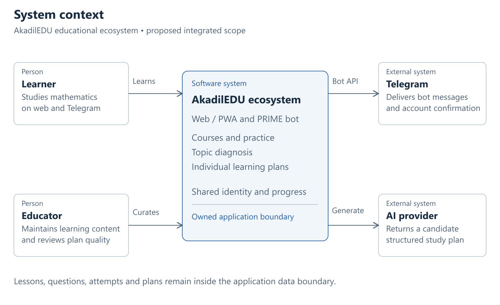

Figure 1. Proposed system context.

Editable source: https://github.com/AQADIL/AkadilEDU/blob/prob-period-1/docs/probationary-period-1/design/system-context.svg

The learner uses the web application or Telegram. Educators manage approved content. The server provides the boundary between learner records and the external AI provider. Only a minimal diagnostic summary and allowed resources are sent for plan generation.

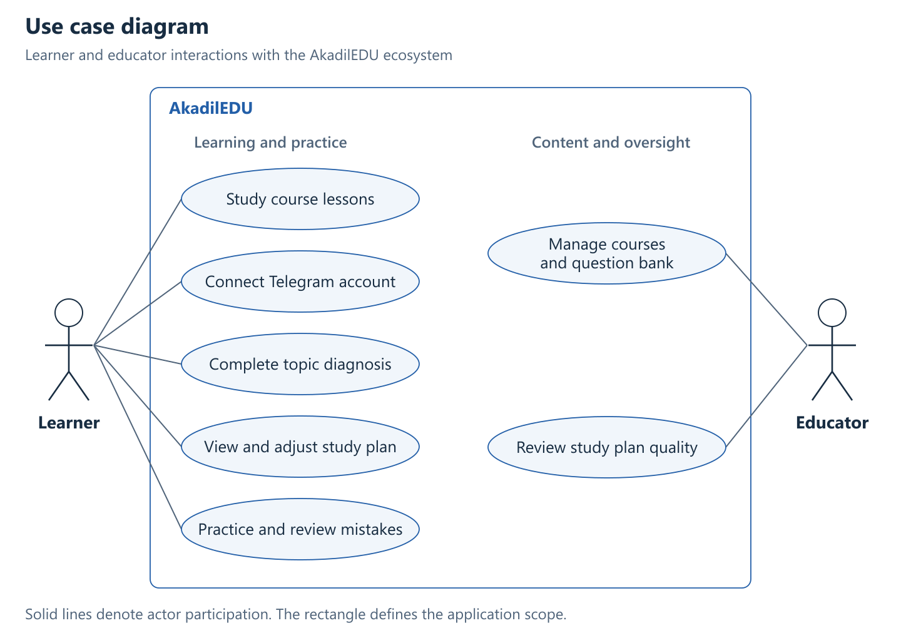

Figure 2. Use case diagram: learner and educator interactions with the ecosystem.

Editable source: https://github.com/AQADIL/AkadilEDU/blob/prob-period-1/docs/probationary-period-1/design/use-cases.svg

Account linking is required before combined progress is shown. A learner can still use existing standalone functions before linking. The diagnostic leads to a plan, and later practice supplies new evidence. Educator review concerns resource quality and plan suitability.

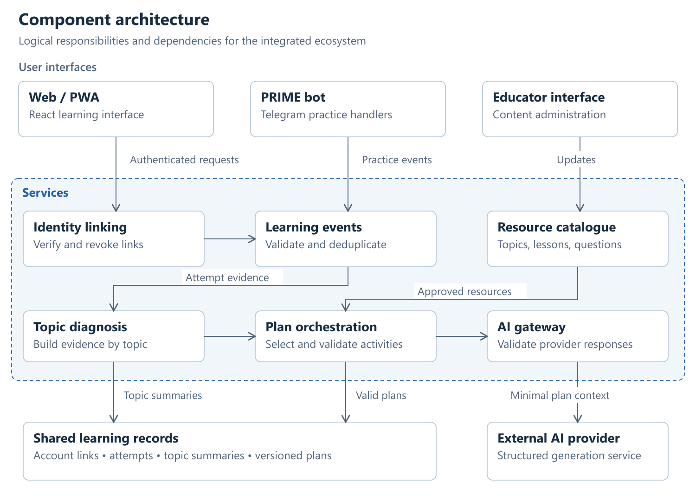

Figure 3. Proposed component architecture.

Editable source: https://github.com/AQADIL/AkadilEDU/blob/prob-period-1/docs/probationary-period-1/design/components.svg

### Data and processing

| Proposed record | Key fields | Invariant |
| --- | --- | --- |
| AccountLink | learnerId, telegramId, verifiedAt, revokedAt | Active linking requires proof of control; revoked links cannot authorize requests. |
| LearningEvent | eventId, learnerId, itemId, topicId, source, result, occurredAt | An event contributes to progress at most once. |
| TopicSummary | learnerId, topicId, distinctItemCount, correctCount, evidenceCutoff | Counts can be reproduced from accepted events. |
| PlanVersion | planId, learnerId, version, evidenceCutoff, steps, generatorVersion | Every step references a valid permitted resource. |
| Resource | resourceId, topicIds, language, publicationStatus | Only published and accessible resources can enter plans. |

Each channel adapter checks identity and converts an attempt to the shared event format. The event service checks the event ID before updating aggregates. The planner reads a consistent summary, generates a candidate plan and validates it before saving a new version. A failed request leaves the previous valid plan available. API contracts and deployment paths will be specified during implementation.

## 8 UX and prototype

The existing web application is available at https://akadiledu.web.app/courses. Figure 4 shows the authenticated course catalogue captured from the live platform on 24 October 2026. The signed-in account has course management permissions. Figures 5-8 specify the new linking, diagnosis, planning and practice flow.

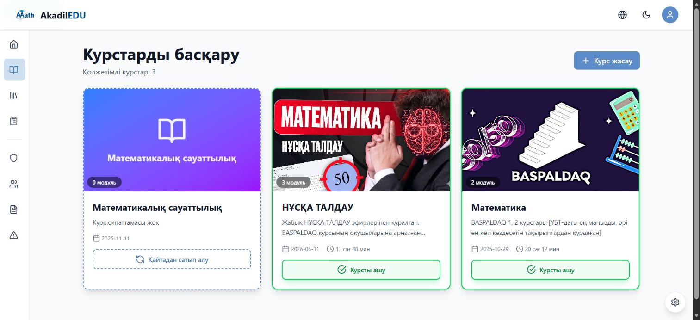

Figure 4. Authenticated course catalogue in AkadilEDU, captured 24 October 2026.

Connect Telegram

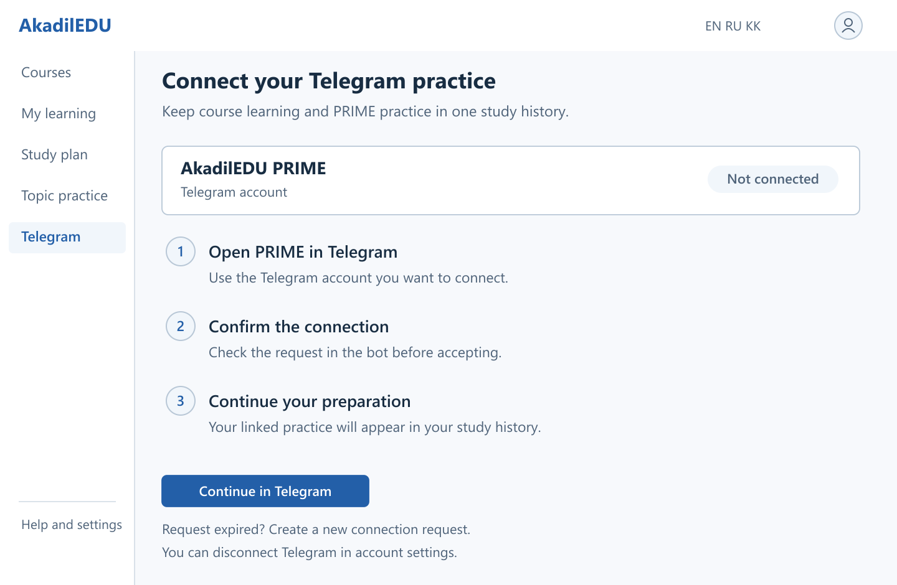

Figure 5. Connect Telegram: proposed interface mockup.

Account linking follows a confirmation in the learner's own Telegram account. The screen keeps the account state visible and explains how to replace an expired request or disconnect later.

Editable source: https://github.com/AQADIL/AkadilEDU/blob/prob-period-1/docs/probationary-period-1/design/prototype-connect.svg

Start the topic diagnostic

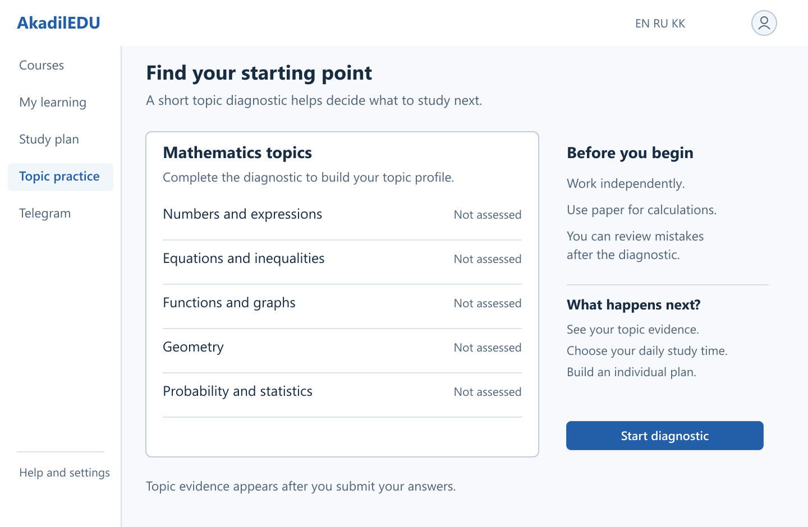

Figure 6. Start the topic diagnostic: proposed interface mockup.

The initial view lists the topic groups without assigning a score before assessment. After submission, the same area will show topic evidence and a recommended next action. An interrupted submission must retain the answers and offer a retry.

Editable source: https://github.com/AQADIL/AkadilEDU/blob/prob-period-1/docs/probationary-period-1/design/prototype-diagnosis.svg

Set a personal study routine

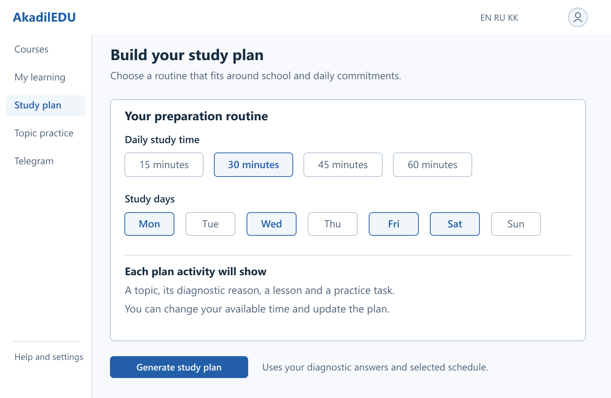

Figure 7. Set a personal study routine: proposed interface mockup.

The learner selects study time and days before generating a plan. Each planned activity will connect a topic to diagnostic evidence and an approved resource. The selected values illustrate the proposed controls. If generation fails, the current valid plan remains available.

Editable source: https://github.com/AQADIL/AkadilEDU/blob/prob-period-1/docs/probationary-period-1/design/prototype-plan.svg

Review a worked solution

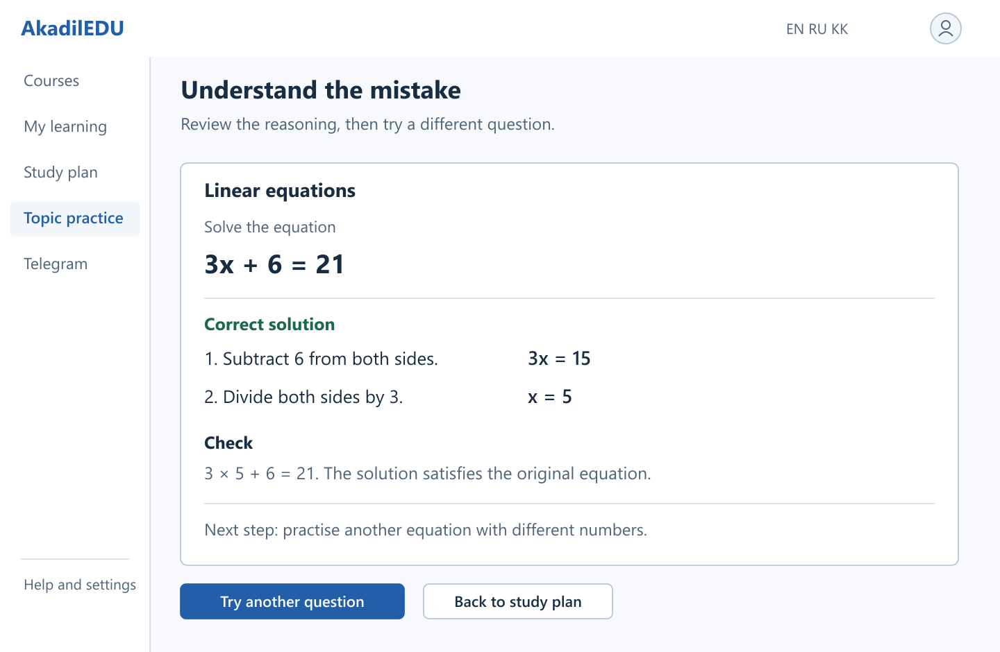

Figure 8. Review a worked solution: proposed interface mockup.

The worked equation illustrates the proposed review layout. The explanation separates the algebraic steps and checks the solution. A follow-up task should use different values. If saving fails, the interface will offer a retry without duplicating the attempt.

Editable source: https://github.com/AQADIL/AkadilEDU/blob/prob-period-1/docs/probationary-period-1/design/prototype-review.svg

Interaction scenarios

Editable source: https://github.com/AQADIL/AkadilEDU/blob/prob-period-1/docs/probationary-period-1/design/prototype-wireframes.svg

| Scenario | User action | Expected behavior |
| --- | --- | --- |
| Start diagnosis | Choose language and complete topic questions | Show topic evidence; ask for more practice if coverage is insufficient. |
| Review a plan | Inspect rationale and available study time | Display linked resources and let the learner adjust time preferences. |
| Continue in Telegram | Use the verified linked account | Show the active plan and appropriate practice entry points. |
| Review a mistake | Open an explanation and try another item | Save the new attempt and update topic history once. |
| Recover from failure | Retry after interrupted synchronization | Retain the attempt identifier and prevent duplicate progress. |
| AI unavailable | Request a plan during a provider failure | Show a valid rule-based plan or a clear retry state. |

A learner links Telegram, completes the diagnostic and chooses a study routine. The plan then explains the next activity and allows changes to the time budget. Practice results update the shared topic history. The screen descriptions and scenario table specify recovery from expired links, interrupted submissions and provider failure. User testing will check whether learners understand the recommendation and can start the next activity without guidance.

## 9 Verification and evaluation plan

Verification begins with identity, data consistency and plan validity, followed by usability and educational evaluation. The table defines the planned checks, conditions and measures. Results will be recorded against the implementation commit.

| Check | Method and conditions | Measure or acceptance |
| --- | --- | --- |
| Identity and authorization | Use two separate test learners; replay expired links and revoked tokens | All unauthorized reads/writes and reused linking challenges fail. |
| Event consistency | Submit duplicate and reordered events from both channels | Aggregates match the accepted unique-event fixture exactly. |
| Diagnosis | Use fixtures with known topic coverage, repeated items and sparse evidence | Output matches the declared diagnostic rules; sparse topics remain uncertain. |
| Plan validity | Run both planners on identical profiles and catalogues | No displayed plan has invalid IDs, inaccessible resources or a time-budget violation. Record rejection and fallback rates. |
| Plan relevance | Have an educator rate plans without the generator label | Use a fixed 1-5 rubric for relevance, sequence and feasibility; record reasons and disagreements. |
| Usability | Ask consenting users to find a weak topic, inspect a plan and start practice | Record task completion, time, errors and comments; report sample and recruitment limitations. |
| Performance | Use a stated environment and 20 concurrent test users | Report p50/p95 latency, errors and provider cost per plan against NFR04 targets. |
| Learning feasibility study | If approved, compare matched-topic pre/post assessments without AI assistance | Report individual changes and group conditions. Do not infer causal impact from a small uncontrolled sample. |

### Baseline and reproducibility

The baseline planner will order eligible weak topics using the same diagnostic evidence and select published resources under the same time budget. The hybrid planner will receive the same inputs. I propose 30 synthetic evaluation profiles covering sparse evidence, uneven topic performance, unavailable resources and different time budgets. Synthetic fixtures will be labeled and kept separate from participant records.

Each evaluation record will include the input fixture ID, provider and model version, prompt version, generation settings, validation outcome, latency and fallback status. The comparison will assess whether plans are valid and useful. An educator will rate both approaches with the same rubric, and the report will state how many reviewers took part. Fluent or lengthy output alone will not satisfy the evaluation criteria.

## 10 Project management and risks

I own the analysis, development and documentation tasks. Elvira Aitmukhanbetova provides academic supervision and reviews selected deliverables. YouTrack records the owner, priority, expected result, acceptance criteria and target date for each task.

Project: https://akadiledu-diploma.youtrack.cloud/issues/AEDUBoard: https://akadiledu-diploma.youtrack.cloud/agiles/204-1/218-1

| Work package | Task references | Milestone and evidence |
| --- | --- | --- |
| Analysis and design | AEDU-1 to AEDU-9 | 24 October checkpoint: proposal, evidence, reviews, requirements, diagrams, prototype and verification plan |
| Documentation and review | AEDU-10, AEDU-11, AEDU-20 | README publication completed; project materials received positive general feedback from the supervisor. |
| Account and progress integration | AEDU-12, AEDU-13 | Proposed next stage: linking by 31 October, shared events by 14 November |
| Diagnosis and plans | AEDU-14, AEDU-17, AEDU-18 | Proposed sequence: planner by 28 November, diagnostic by 5 December, plan interfaces by 12 December |

Dates after the first checkpoint are planning targets. The captured YouTrack board and task views below show the task structure, owner, priorities, dates and statuses on 22 October 2026. AEDU-20 documents the completed README publication with acceptance criteria and delivery commits.

| Risk | Effect | Response |
| --- | --- | --- |
| Limited range of user contexts | Requirements may miss other study situations | Use the four discussions for initial requirements and include different device and study conditions in usability checks. |
| Incorrect topic mapping | Misleading diagnosis and plan | Review taxonomy and item mappings; keep evidence visible. |
| Invalid AI suggestions | Unusable or inappropriate plan | Validate resource references; apply a rule-based fallback and educator review. |
| Duplicate events or wrong account link | Corrupt or exposed learner progress | Use verified linking, unique event IDs and authorization checks. |
| Provider cost or outage | Delayed generation | Bound requests, log costs and retain a provider-independent baseline. |
| Solo workload | Late integration and documentation | Prioritize Must requirements and keep optional features out of the critical path. |
| Version mismatch | Report cannot be reproduced from submitted tag | Commit supporting files and agree the final snapshot before submitting the form. |

### Repository baseline and submission version

| Component | Application baseline commit |
| --- | --- |
| Web/PWA | 44bafc3a5754f6c072bbf8c54d2625b58a8cba5a |
| Telegram | b5d0bfb401d8965f1b80b8e904c097bb43597e0c |

https://github.com/AQADIL/AkadilEDU/tree/prob-period-1https://github.com/AQADIL/AkadilEDU-PRIME/tree/prob-period-1

The prob-period-1 tags contain the application baselines listed above together with the consolidated report and design materials. Both repositories use the same report file for this checkpoint.

The web repository provides npm test and npm run check. The bot repository provides component build and lint workflows described in its README. The final verification record will identify the exact commit and commands used. Test failure, exclusion and missing data will remain visible in the results.

### YouTrack board overview

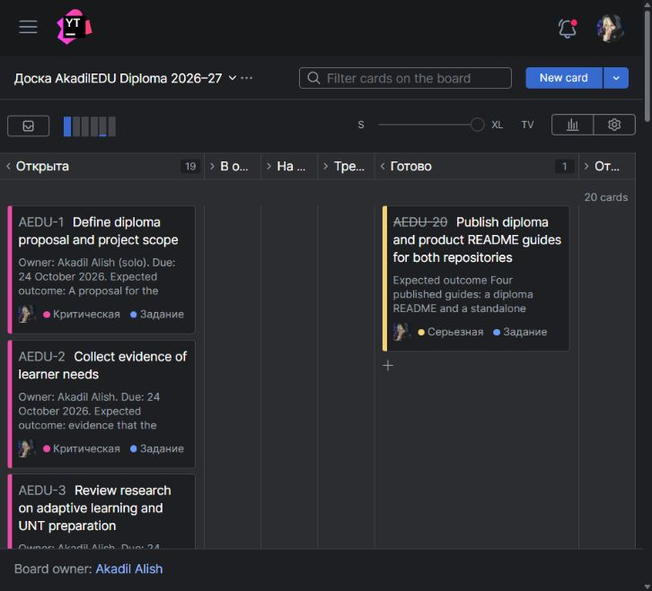

Figure 9. YouTrack board overview, captured 22 October 2026.

### Completed documentation task

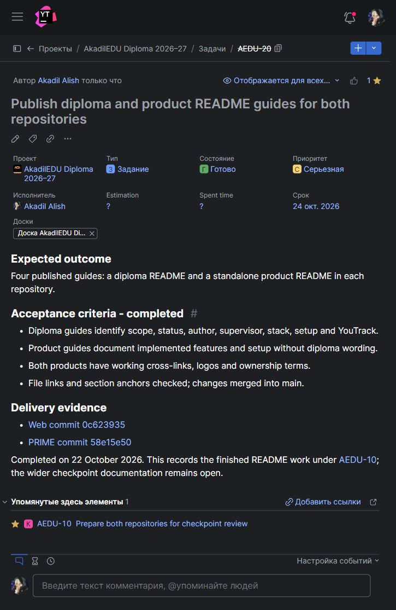

Figure 10. Completed task AEDU-20: assignee, priority, deadline, acceptance criteria and commit evidence.

Web documentation commit: https://github.com/AQADIL/AkadilEDU/commit/0c62393547b8165acff2a95a54de9067165b0cfd

Telegram documentation commit: https://github.com/AQADIL/AkadilEDU-PRIME/commit/58e15e50f561a1ff36dfd64215c1326499afb506

### Requirements task

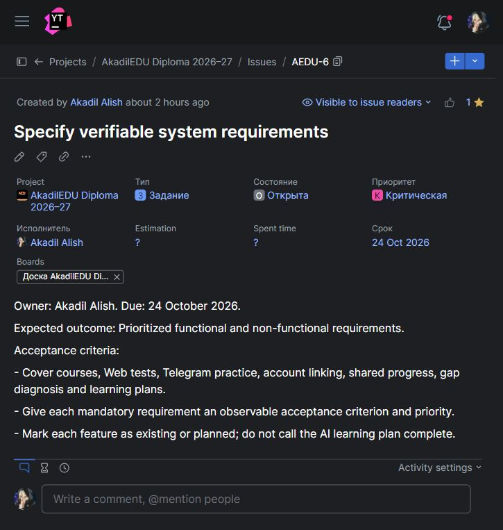

Figure 11. Requirements task: owner, priority, target date and expected deliverables.

## 11 Supervisor feedback

Elvira Aitmukhanbetova reviewed the submitted project materials and gave positive general feedback. No specific corrections were requested.

Following this review, I retain the agreed project direction and proceed with the next stage: account linking, shared learning records and individual study plans. The requirements, diagrams and verification plan in this report guide that work.

## Supporting materials

The editable-materials folder contains three diagram sources, four detailed interface mockups and their PNG exports. These materials are included in the tagged repository version. The interview package and YouTrack evidence are linked below.

Interview and supporting folder: https://drive.google.com/drive/folders/1Tu-GkpZOWcqZGtE-whxeT8wxaD2wDqcR?usp=sharing

Existing web interface: https://akadiledu.web.appYouTrack board: https://akadiledu-diploma.youtrack.cloud/agiles/204-1/218-1

Published design index: https://github.com/AQADIL/AkadilEDU/blob/prob-period-1/docs/probationary-period-1/design/README.md

Readable prototype: https://github.com/AQADIL/AkadilEDU/blob/prob-period-1/docs/probationary-period-1/design/prototype-wireframes.png

## References

[1] Abdelrahman, G., Wang, Q., and Nunes, B. (2023). Knowledge Tracing: A Survey. ACM Computing Surveys, 55(11).https://doi.org/10.1145/3569576

[2] Khosravi, H., et al. (2022). Explainable Artificial Intelligence in education. Computers and Education: Artificial Intelligence, 3, 100074.https://doi.org/10.1016/j.caeai.2022.100074

[3] Agarwal, P. K., Nunes, L. D., and Blunt, J. R. (2021). Retrieval Practice Consistently Benefits Student Learning: a Systematic Review of Applied Research in Schools and Classrooms. Educational Psychology Review, 33, 1409-1453.https://doi.org/10.1007/s10648-021-09595-9

[4] Bastani, H., et al. (2025). Generative AI without guardrails can harm learning: Evidence from high school mathematics. PNAS, 122(26), e2422633122.https://pmc.ncbi.nlm.nih.gov/articles/PMC12232635/

[5] Kestin, G., et al. (2025). AI tutoring outperforms in-class active learning: an RCT introducing a novel research-based design in an authentic educational setting. Scientific Reports, 15, 17458.https://www.nature.com/articles/s41598-025-97652-6

[6] Baker, R. S., and Hawn, A. (2022). Algorithmic Bias in Education. International Journal of Artificial Intelligence in Education, 32, 1052-1092.https://doi.org/10.1007/s40593-021-00285-9

[7] Kulik, J. A., and Fletcher, J. D. (2016). Effectiveness of Intelligent Tutoring Systems: A Meta-Analytic Review. Review of Educational Research, 86(1), 42-78.https://doi.org/10.3102/0034654315581420

[8] Kasneci, E., et al. (2023). ChatGPT for good? On opportunities and challenges of large language models for education. Learning and Individual Differences, 103, 102274.https://doi.org/10.1016/j.lindif.2023.102274

[9] Okonkwo, C. W., and Ade-Ibijola, A. (2021). Chatbots applications in education: A systematic review. Computers and Education: Artificial Intelligence, 2, 100033.https://doi.org/10.1016/j.caeai.2021.100033

[10] Crompton, H., and Burke, D. (2023). Artificial intelligence in higher education: the state of the field. International Journal of Educational Technology in Higher Education, 20, 22.https://doi.org/10.1186/s41239-023-00392-8

[11] Wollny, S., Schneider, J., Di Mitri, D., Weidlich, J., Rittberger, M., and Drachsler, H. (2021). Are We There Yet? - A Systematic Literature Review on Chatbots in Education. Frontiers in Artificial Intelligence, 4, 654924.https://doi.org/10.3389/frai.2021.654924

[12] Ogunleye, B., Zakariyyah, K. I., Ajao, O., Olayinka, O., and Sharma, H. (2024). A Systematic Review of Generative AI for Teaching and Learning Practice. Education Sciences, 14(6), 636.https://doi.org/10.3390/educsci14060636

[13] Lo, C. K. (2023). What Is the Impact of ChatGPT on Education? A Rapid Review of the Literature. Education Sciences, 13(4), 410.https://doi.org/10.3390/educsci13040410

[14] Celik, I., Dindar, M., Muukkonen, H., and Järvelä, S. (2022). The Promises and Challenges of Artificial Intelligence for Teachers: a Systematic Review of Research. TechTrends, 66, 616-630.https://doi.org/10.1007/s11528-022-00715-y

[15] Zawacki-Richter, O., Marín, V. I., Bond, M., and Gouverneur, F. (2019). Systematic review of research on artificial intelligence applications in higher education - where are the educators? International Journal of Educational Technology in Higher Education, 16, 39.https://doi.org/10.1186/s41239-019-0171-0

[16] Daryn.online. UNT preparation course description. Accessed 24 October 2026.https://course.daryn.online/

[17] Khan Academy. What is self-paced Mastery? Accessed 23 October 2026.https://support.khanacademy.org/hc/en-us/articles/360007253831-What-is-self-paced-Mastery

[18] MoodleDocs. Quiz activity; Activity completion report. Accessed 23 October 2026.https://docs.moodle.org/502/en/Quiz_activityhttps://docs.moodle.org/502/en/Activity_completion_report

[19] JUZ40. Online UNT preparation and course information. Accessed 24 October 2026.https://juz40-edu.kz/

[20] Firebase. Choose a Database: Cloud Firestore or Realtime Database. Accessed 23 October 2026.https://firebase.google.com/docs/database/rtdb-vs-firestore
